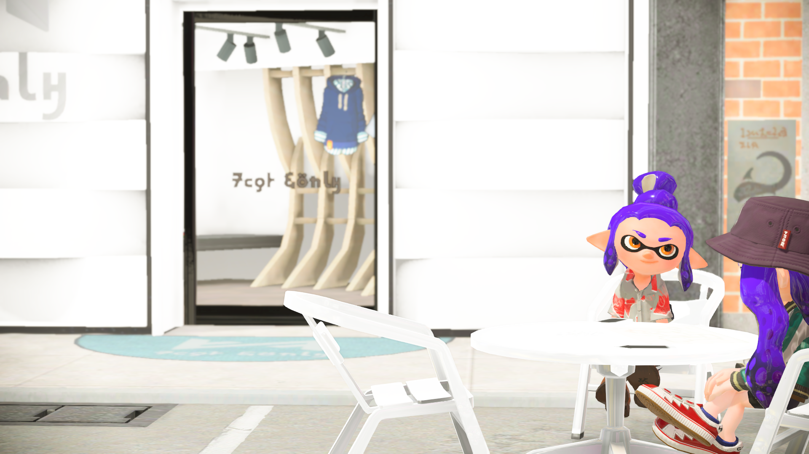

# Plaza Inkling faces: retained texture-copy descriptors

The café Inklings previously had holes and colored speckles across their faces,
necks and ears. The generated body albedo contained corrupt pixels and alpha;
the body shader discarded affected fragments at its normal 0.5 alpha threshold.
The meshes and material shaders were present.

## Cause and change

`Game::MaskCommand::draw` generates the body albedo and mipmaps, then calls
`agl::TextureData::copyToAll` to copy them into the `Game::AlbedoData` texture.
Both copy operands are copied NVN descriptors. The old copy recorder retained
only their guest addresses. Replay passed those addresses to `ensure_contents`,
which requires a registered host `Texture`; copied descriptors had none, so the
copy returned without writing the body atlas. Following the named live object
would also be wrong: that object can already describe another surface.

The copy recorder now uses the existing `record_texture_descriptor` API for
both operands and retains their owners with the command list. Copy views,
regions, mip levels, layers, filtering and mirror flags keep their existing values.
No guest shader, skin color, alpha threshold or input behavior is changed.

## Apply and regression checks

Apply after the [PlayerMake descriptor-identity fix](PLAYERMAKE_FIX.md):

```sh
python3 tools/patches/patch-plaza-texture-copy-descriptors.py --root /path/to/sp2port --check
python3 tools/patches/patch-plaza-texture-copy-descriptors.py --root /path/to/sp2port
```

Rebuild the runtime. `--restore` reverses only this patch. The public patch
contains no generated guest code, game assets or executable.

The source-extracted copy regression exercises source/destination descriptor
copies, mixed and direct operands, reused scratch addresses and named objects,
retained command-list lifetimes, views, regions and flags. The old recorder fails
on unresolved replay operands; the fixed recorder passes under ASan/UBSan.
All ten groups in `tools/verify-tutorial-runtime.py` pass. The patch helper also
passes isolated apply, check, repeated apply, restore and unsupported-source checks.

## Windows verification on November 22, 2026

An isolated capture run reproduced the café scene with intact faces, ears, necks,
arms and legs. Runtime logs show copies of all ten body-atlas mip levels reaching
the intended static destination. The sampled 512x256 RGBA8 body albedo is now a
recognizable skin atlas, rather than colored noise. Fully opaque alpha covers
77.51% of its texels, versus 1.54% in the broken capture. Unused atlas areas and
intentional cutouts mean full opaque coverage is not expected.



The NPC outfits and camera timing differ between runs; this is visual scene
verification, not a pixel-identical image comparison. The capture and the source
regressions establish this copy defect; they do not establish whole-game graphics
correctness. Tutorial ink and manual input remain outside this plaza fix.

A separate run of `sp2-plaza-faces.exe` without RenderDoc also rendered intact
café faces at frame 3000. The capture and normal run logged no device-lost,
image-allocation-failure, upload-buffer-full or mid-pass-upload/transition message.
The normal-run candidate is SHA256
`5979EFF8C23ED908D1DCCAC7CF60D2CCE83CCC10FB41844755F9B6BC2B0D11D5`.
Its isolated local evidence is `C:\sp2stage\plaza_face_20261122_231554`.

Local evidence: `C:\sp2stage\plaza_face_20261122_231148` (fixed capture),
`C:\sp2stage\plaza_face_20261122_211118` (broken capture), and their
`atlas_verification/report.json` files. Captures were replayed after the live
game exited. Plaza routes retain the historical inputs and existing explicit
tutorial diagnostic skips; these runs do not demonstrate tutorial completion.
