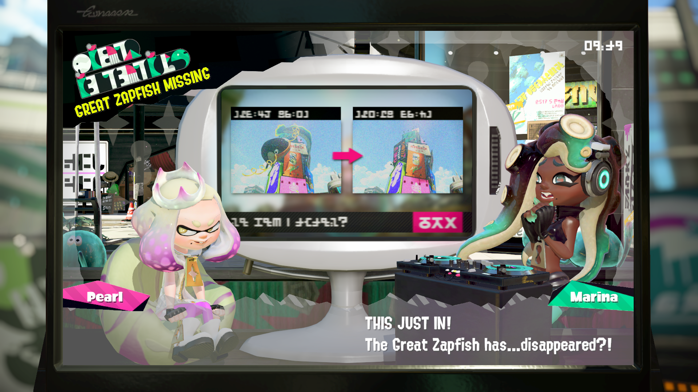
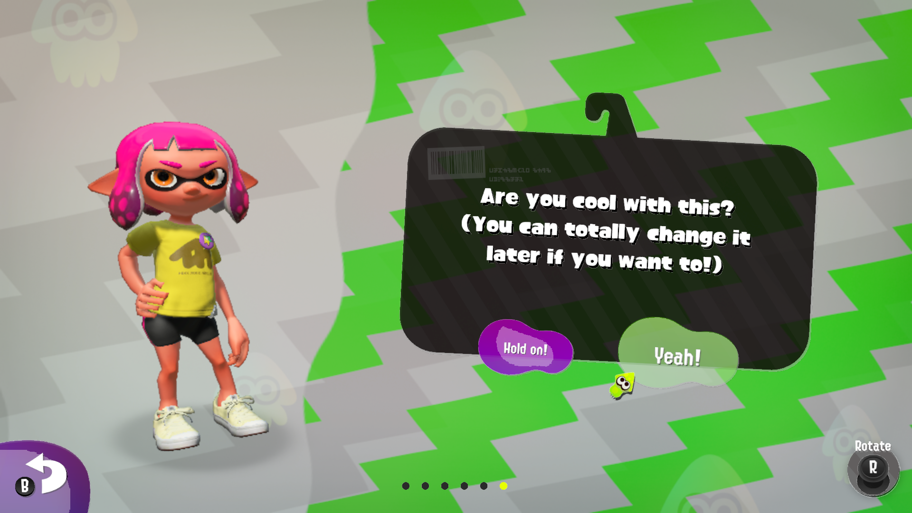

# Plaza/news texture contents, precision and eyebrow depth

The plaza and Off the Hook news scene were washed out, the news text had missing
letters, and bright surfaces and hosts had black stippling. Eyebrows also appeared
to sink into the face in PlayerMake and the square.

## Runtime changes

- **Keep zero textures zero.** A previous missing-atlas workaround replaced
  apparently empty uploads with `(1,1,1,1)`. Zero is valid data for lighting,
  emission and coverage maps. That substitution injected white into otherwise
  black textures. It is removed; the texture-copy descriptor fix handles the
  original missing body atlas. The game's exposure and lighting settings remain
  authoritative.
- **Refresh cached texture contents.** A descriptor can sample an image retained
  by the shared image cache without owning it through `Texture::image`. Readiness
  and CPU-content checks now resolve that image through `image_of`, allowing the
  live glyph atlas to refresh before deciding whether to keep a render pass open.
- **Preserve sine precision near pi.** A scalar FP32 sine in area-light material
  code was rounded to zero near pi on the tested GPU. Its reciprocal became
  infinite, then a zero product became NaN. Generic scalar sine operations near
  positive or negative pi now use split-constant range reduction. Other inputs
  retain the original operation. This is a precision compatibility transform,
  with no shader-hash replacement or forced output colors.
- **Keep native Vulkan depth ordering.** The Metal depth-pass tolerance added a
  negative constant and slope bias to color passes. Captured face pixels moved
  ahead of nearer eyebrow geometry and overwrote it. Native Vulkan now defaults
  to zero extra tolerance. The existing Metal default and explicit diagnostic
  override remain available; normal game polygon offsets are preserved.

## Local verification

The user confirmed the missing text, grain and excessive white brightness were
resolved. A controlled run with the old white-fill fallback disabled retained
PlayerMake faces and clothes and rendered shaded news surfaces. The news HDR
scene contained no NaN or infinite pixels. Runtime exposure arithmetic was traced
back to the original guest shader and retained.



An eyebrow pixel trace demonstrates the separate depth defect. In the original
capture at `(470,370)`, the eyebrow depth was `0.997368455`; the face was behind it
at `0.997369885`. The added tolerance moved the face color depth to
`0.997368217`, allowing it to overwrite the eyebrow. In the comparison capture,
four sampled eyebrow positions retained their depth and the face color pass
failed the depth test behind them. The user confirmed the revised appearance.
PlayerMake skin, clothes and text remained
visible. Camera pose and dynamic resolution differ between these captures.



The actual-source CPU regression suite now has 15 groups, including zero texture
uploads, cache-owned texture refresh, sine precision and platform-specific depth
tolerance. They run with ASan/UBSan. The incremental patch helper was checked for
byte-exact apply, idempotence, restore and refusal without partial changes.

## Story-mode black objects

The story-mode capture also contained black trees, balloons and crates. This is
a distinct shader-cache coverage problem: color draws had missing translated
stages, while depth-only draws still ran. All 67 missing stages from that run
(58 fragment, 9 vertex) translated on their first attempt and passed SPIR-V
validation for Vulkan 1.2. Only those missing cache entries and their binding
metadata were installed locally. Game-derived shader files are private and are
not included in this repository.

Use the translation tool with explicit directories for a local game dump; restart
the game afterward because missing stages are cached for the running process.
Existing entries are preserved; hash/pair checks and SPIR-V validation must pass
before any missing stages are installed. `SPIRV_VAL` can select a Linux validator
or a Windows SDK `spirv-val.exe` when running under WSL.

```sh
SP2PORT=/path/to/sp2port SPIRV_VAL=/path/to/spirv-val \
  bash tools/wsl/wsl-translate-shaders.sh /path/to/private/shader_misses /path/to/private/spirv
python3 tools/tests/test_shader_miss_workflow.py
```

The isolated workflow test uses fake translator/validator programs to check
validated-only additions, preserved cache and metadata, idempotence, input and
validation failures, and temporary-file cleanup.

## Apply and check

Apply after the published PlayerMake, tutorial-lighting, sampler-copy and plaza
texture-copy fixes:

```sh
python3 tools/patches/patch-plaza-news-rendering.py --root /path/to/sp2port --check
python3 tools/patches/patch-plaza-news-rendering.py --root /path/to/sp2port
python3 tools/verify-tutorial-runtime.py --root /path/to/sp2port
```

Rebuild changed runtime sources and relink. `--restore` removes only this
incremental patch. It contains no generated game code, game assets or executable.
Input and tutorial ink remain outside this follow-up. Historical route inputs
and explicit tutorial skips were used for diagnostic access; this is not evidence
of an unmodified tutorial clear or whole-game rendering correctness.
